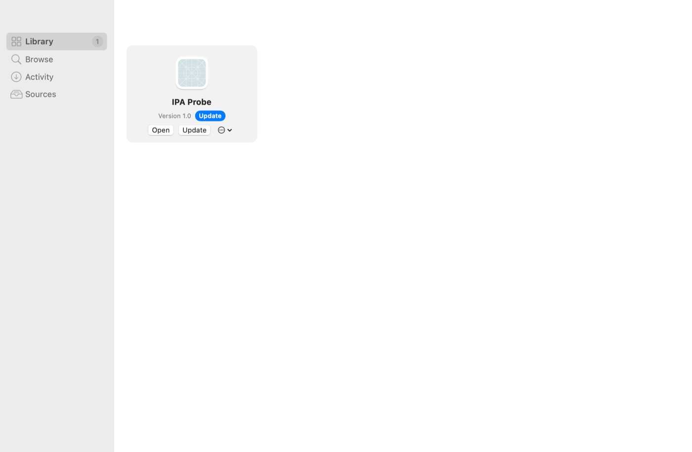
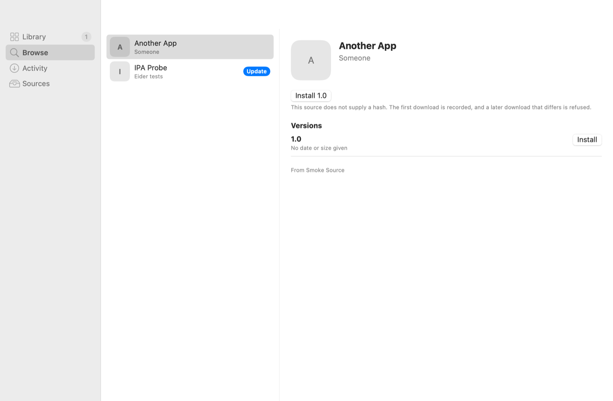

# Eider

Eider adds sources (repository JSON files), downloads the iOS `.ipa` archives
they list, and installs each one as an ordinary Mac app on Apple silicon. It
comes as a command line tool, `eider`, and a SwiftUI app, `Eider.app`.

## Status

Early: version 0.1.0. Apple silicon only, macOS 14 or later. Expect rough
edges; read "What does not work" before installing anything you depend on.

## Install

With Homebrew:

```
brew tap ayush5harma/eider https://github.com/ayush5harma/eider
brew install --cask eider
```

Or download `Eider-0.1.0.zip` from the project's GitHub releases and move
`Eider.app` to `/Applications`. The app bundle carries the CLI at
`Eider.app/Contents/Resources/cli/bin/eider`; the cask links it onto your PATH.

Eider is ad hoc signed, not notarized. The first time you open it, approve it
once in System Settings > Privacy & Security.

## Command line

`eider --help` lists the commands and `eider help <command>` explains each.
Every command takes `--json` (one JSON object per line, the last is the
result). Exit codes: 0 success, 1 usage error, 2 failure.

```
eider source add https://example.com/source.json   # add a source
eider source list                                  # sources you added
eider source refresh                               # fetch them all again
eider search camera                                # find an app
eider info com.example.app                         # what the sources offer
eider install com.example.app                      # newest version, from a source
eider install com.example.app --version 1.2.0
eider install ~/Downloads/App.ipa                  # a file, or an https address
eider list                                         # installed apps, updates marked
eider update --all                                 # or: eider update <bundle-id>
eider open com.example.app                         # launch and confirm it stays up
eider doctor com.example.app                       # launch; if it dies, say why
eider uninstall com.example.app --remove-data      # to the Trash
```

Useful `install` options: `--dest <folder>` (default `/Applications`),
`--mac-idiom`, `--no-keychain`, `--dylib <file>`, `--name`, `--bundle-id`,
`--remove-extensions`, `--reset` (clear saved data first; the app must be
quit) and `--force`. The argument is treated as a file only when it contains
a slash or ends in `.ipa`; otherwise it is a bundle id.

Sources can be in the AltStore or the PlayCover format; see
[docs/SOURCES.md](docs/SOURCES.md). Eider ships no sources.

## The app

`Eider.app` has four places: Library (what you installed, with updates),
Browse (the apps your sources offer), Activity (downloads and installs in
progress) and Sources (add, refresh and remove them). Dropping an `.ipa` on
the window installs it. An `eider://source/<url>` or `eider://install/<url>`
link always asks before it does anything. The app and the CLI share one
engine, `EiderKit`, so they behave the same.

The Library and Browse sections, drawn by the app's own `--snapshot` mode against a test source:





## How an install works

1. Unpack the archive, refusing unsafe entries, and find the one `Payload/*.app`.
2. Read `Info.plist`; refuse an unsafe bundle id, executable or name.
3. Refuse any binary that is still FairPlay-encrypted.
4. Convert every Mach-O: thin to arm64, rewrite the platform to Mac Catalyst
   (each binary keeps its own SDK version), repoint the Swift UIKit overlay.
5. Edit `Info.plist` (`MinimumOSVersion`, the Mac idiom if asked, name and id).
6. Link the shims below into the main executable.
7. Sign every binary and nested bundle ad hoc, then the app with a sandbox
   entitlement set, and verify each signature strictly.
8. Stage the app on the destination volume, move any earlier copy to the
   Trash, move the new one in, and record it in `library.json`.

No Xcode or Command Line Tools are needed to install: the install path runs
only `codesign`, `unzip` and `lsregister`. The `legacy/` folder holds the
shell installer this came from and the measurements behind the steps.

### The shims

An ad hoc signature gets no keychain, no app groups and no usable OpenGL, so
three small libraries are linked in (built by `Scripts/build-shims.sh`):

- keychain: an emulated keychain stored in the app's container, so a sign-in
  survives a relaunch (`--no-keychain` opts out).
- OpenGL ES: run-time GL lookups are answered by OpenGL ES instead of desktop
  OpenGL, for apps that link OpenGL ES.
- app groups: a writable app-group folder inside the app's own container,
  because macOS denies an ad hoc signed app its real ones.

A bundled "keychain fix" tweak library is replaced by an empty one so it
cannot defeat the keychain shim.

## What does not work

- Encrypted IPAs (App Store downloads) are refused. Eider decrypts nothing.
- Push notifications, iCloud and in-app purchase need a real signature and
  entitlements; under an ad hoc signature they do not work.
- App extensions are outside the shims (`--remove-extensions` drops them,
  which often helps an app that will not sign or open).
- Logins stored by the keychain shim are a plain file under ordinary file
  permissions in the app's container, not behind your login password.
- Game controls through PlayTools exist only in `legacy/`, not in Eider.
- An app built for a newer iOS than it adopted behaves as it would there.
  Some apps break under `--mac-idiom`.

## Security model

- Sources, IPAs, their `Info.plist` files and file names are untrusted: https
  only (http only to this Mac, and only for a source you added by a loopback
  address), checked on every redirect.
- Archive entries may not escape the extraction folder, symlinks are recreated
  only with relative targets without `..`, and the 8 GB cap counts bytes
  actually written.
- Nothing from an IPA runs during install; names are stripped of control and
  bidi characters; bundle ids are validated before they become paths.
- A catalog install must yield the app the source listed, and a bundle already
  at the destination is replaced only if Eider installed it or you pass
  `--force`; the old copy goes to the Trash, never deleted.
- Downloads are checked against a published SHA-256 and the first hash an
  address ever served, and resume only against the same address and version.

Report vulnerabilities as described in [SECURITY.md](SECURITY.md).

## Building and testing

```
swift build
swift test
Scripts/build-shims.sh      # compile the shims into build/shims
Scripts/engine-e2e.sh       # install engine, judged by effect, 26 checks
Scripts/e2e.sh              # source, install, update, doctor, uninstall
Scripts/make-app.sh         # assemble and ad hoc sign build/Eider.app
```

The end-to-end scripts install only into temporary folders and run `eider`
as on a Mac with no developer tools. See [CONTRIBUTING.md](CONTRIBUTING.md)
and [docs/ARCHITECTURE.md](docs/ARCHITECTURE.md).

## Credits

Inspired by Feather (sources) and PlayCover (the install mechanism). Eider is
not affiliated with either and contains no code from them or from PlayTools.
MIT licence; see [LICENSE](LICENSE).
